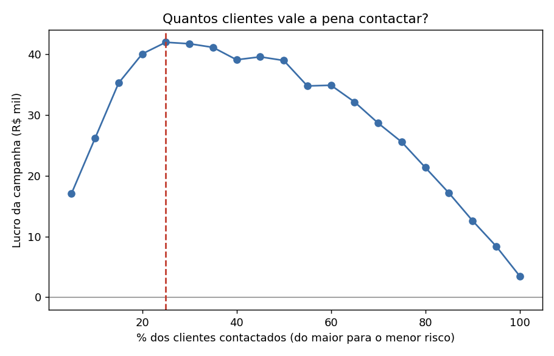

# Previsão de churn em cartão de crédito
Link do APP: projetochurn-7wq6q3bg6yxvfxqtgvxonu

Projeto de ciência de dados que prevê quais clientes de cartão de crédito têm maior chance de cancelar o cartão nos próximos 90 dias e mostra quanto dinheiro uma campanha de retenção pode gerar.

> **Aviso:** a base de dados é **sintética** (criada por código, sem nenhum cliente real). Os padrões foram definidos por mim, então os resultados servem para demonstrar o método e não provam o desempenho em um banco real.

**Autor:** Vânio Tosta, cientista de dados

## Problema de negócio

Conquistar um cliente novo custa mais do que manter um que já existe. Se o banco souber quem está prestes a sair, pode oferecer uma condição especial antes disso. Mas contactar todo mundo custa caro. A pergunta do projeto é: **para quais clientes vale a pena ligar?**

## Resultados

| Modelo | AUC (validação cruzada) | AUC (teste) |
|---|---|---|
| Regressão logística (primeira versão) | 0,775 | 0,761 |
| **Regressão logística ajustada (modelo final)** | **0,776** | **0,766** |
| Gradient Boosting ajustado | 0,772 | 0,761 |
| Random Forest ajustado | 0,764 | 0,755 |

- O modelo final foi escolhido pela validação cruzada no treino. O teste só foi usado para mostrar o resultado.
- Ligando só para os **20% de maior risco**, o banco encontra cerca de **52% dos cancelamentos**. A taxa de acerto nesse grupo é **2,6 vezes** a da base inteira (44,5% contra 17,2%).
- As variáveis novas e o ajuste de parâmetros deram um ganho pequeno (AUC de 0,761 para 0,766).
- Sinais que mais pesam: queda do gasto, meses sem usar o cartão, atrasos, reclamações e nota de satisfação (NPS).

### Impacto financeiro (hipóteses)

Considerando que um cliente retido gera R$ 1.200 por ano, que cada contato custa R$ 60 e que 30% dos clientes contactados aceitam ficar, o melhor é contactar os **25% de maior risco**: lucro de **R$ 42 mil** só nos 2.000 clientes do teste, contra R$ 3,5 mil se todos fossem contactados. Esses três valores são suposições e ficam no início da seção "lucro" de `modelagem_v2.py`, prontos para trocar pelos números reais da empresa.



## Etapas do projeto

| Etapa | Arquivo | O que faz |
|---|---|---|
| 1 | `gerar_base_churn_cartao.py` | Gera a base sintética (10.000 clientes, 32 colunas, 17% de churn) |
| 2 | `tratar_faltantes.py` | Trata os valores faltantes (NPS, renda e escolaridade) |
| 3 | `eda_e_divisao.py` | Divide em treino e teste e faz a análise exploratória |
| 4 | `modelagem_churn.py` | Primeiros modelos (referência) |
| 5 | `modelagem_v2.py` | Variáveis novas, ajuste de parâmetros e modelo final |
| 6 | `app.py` | App em Streamlit para consultar o risco |

Outros arquivos: `churn_utils.py` (funções compartilhadas), `dicionario_variaveis.csv` (significado das colunas), gráficos `.png` e `resultados_v2.csv`.

## Decisões importantes

- **Divisão antes do tratamento:** a base foi dividida em treino e teste antes de preencher os faltantes, e as medianas vêm só do treino. Assim o teste não "enxerga" informação que o modelo não deveria conhecer.
- **Colunas marcadoras:** `nps_faltante` e `renda_faltante` guardam a informação de que o dado não existia.
- **Variáveis novas:** peso da anuidade sobre o gasto, rotativo sobre o limite, e um contador de sinais de alerta (0 a 5).
- **Métrica:** AUC e acerto entre os clientes de maior risco, e não só acurácia, porque a base é desbalanceada.

## Como rodar

```bash
pip install -r requirements.txt

python gerar_base_churn_cartao.py
python eda_e_divisao.py
python modelagem_v2.py       # gera o modelo usado pelo app
streamlit run app.py
```

No app, a aba "Um cliente" calcula o risco de um cliente e lista os sinais de alerta, e a aba "Lista de clientes" aceita um CSV (use `base_teste.csv` para testar) e devolve o risco de cada um.

O arquivo `modelo_churn.joblib` foi salvo com a versão do scikit-learn usada no projeto. Se aparecer um aviso de versão, rode `modelagem_v2.py` de novo para gerar o modelo na sua máquina.

## Limitações e próximos passos

- Com dados reais, os modelos de árvore costumam ir melhor do que aqui, e vale testar LightGBM e XGBoost.
- Falta calibrar as probabilidades e acompanhar o modelo depois de publicado (queda de desempenho ao longo do tempo).
- Um próximo passo de negócio é medir quem realmente muda de decisão com a oferta (modelo de uplift), e não só quem tem risco alto.
- Empacotar o treino com MLflow para registrar os experimentos.
